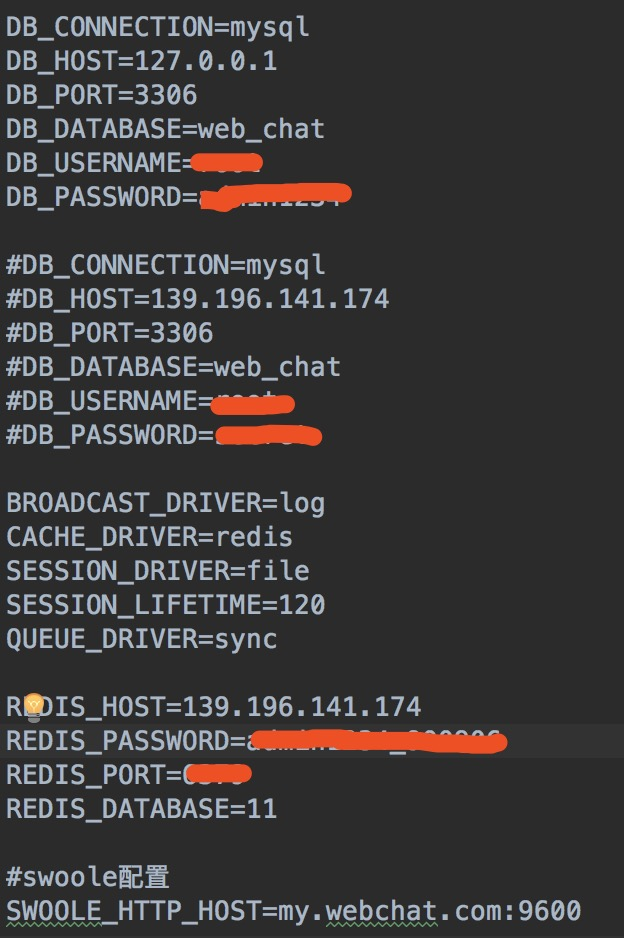
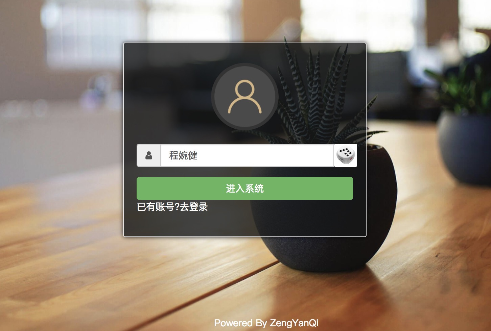
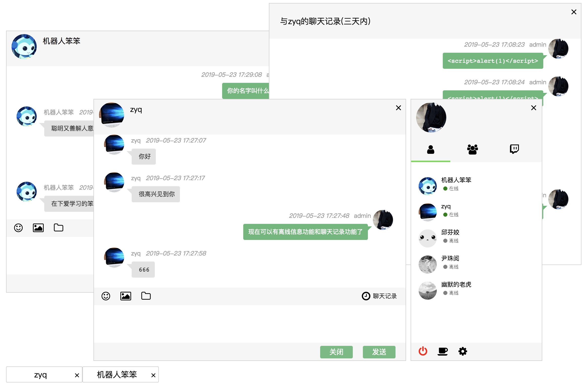

# web_chat

> jacky-zeng's web_chat
``` bash

Laravel5.6(后端php框架) + Swoole(韩天峰的写的) + css,html,jquery(未使用前端框架，纯css+jq+html)

```

# 安装&服务管理


>  laravel安装： composer install

>  mysql使用： 新建数据库：web_chat ；生成表：php artisan migrate
    
>  laravel配置：

>  

>  env参考

```
APP_NAME=web_chat
APP_ENV=local
APP_KEY=base64:+mXWIML/TYRlwsYhE6MDi3dT1RR6dC4DMp9WWqISbcI=
APP_DEBUG=true
APP_URL=http://localhost

LOG_CHANNEL=stack

DB_CONNECTION=mysql
DB_HOST=mysql8
DB_PORT=3306
DB_DATABASE=web_chat
DB_USERNAME=root
DB_PASSWORD=xxxxxxxxx

BROADCAST_DRIVER=log
CACHE_DRIVER=redis
SESSION_DRIVER=file
SESSION_LIFETIME=120
QUEUE_DRIVER=sync

REDIS_HOST=redis-server
REDIS_PASSWORD=xxxxxxxxx
REDIS_PORT=6379
REDIS_DB=12

SWOOLE_HTTP_HOST=0.0.0.0
SWOOLE_HTTP_HOST2=chat.zengyanqi.com
```

>  nginx配置：
```
server {
    listen 80;
    server_name chat.zengyanqi.com;
    root /var/www/www/web_chat/public;  # 静态文件根目录

    location / {
        # 尝试访问静态文件，如果不存在则转发给 @swoole 处理
        try_files $uri $uri/ @swoole;
    }

    location @swoole {
        proxy_pass http://127.0.0.1:1215;

        # 递真实的域名，而不是 127.0.0.1
        proxy_set_header Host $host;
        proxy_set_header X-Real-IP $remote_addr;
        proxy_set_header X-Forwarded-For $proxy_add_x_forwarded_for;
        proxy_set_header X-Forwarded-Proto $scheme;
    }
}

```

>  启动HTTP服务(也就是127.0.0.1:1215)：php artisan swoole:http start

>  启动聊天服务(也就是chat.zengyanqi.com:9600)：php artisan swoole:chat start

>  关闭聊天服务：php artisan swoole:chat stop


# 说明

>  如果对您有帮助，您可以点右上角 "Star" 支持一下 谢谢！ ^_^

>  安装及部署可参考博客地址[Swoole 自学](http://www.zengyanqi.com/2018/11/24/swoole-study-8-laravel-swoole/)

>  项目地址[web_chat](http://chat.zengyanqi.com/chat)

# 项目截图

> 登录页面


> 聊天页面



# 目标功能
- [x] 登录注册&游客登录&退出登录 -- 完成
- [x] 聊天主面板 -- 完成
- [x] 聊天一对一面板 -- 完成
- [x] 聊天对话框切换 -- 完成
- [x] 聊天机器人 -- 完成 ✨✨🎉🎉
- [x] 离线消息 -- 完成 (20190523)
- [x] 表情功能 -- 完成 (20190530)
- [x] 图片上传功能 -- 完成 (20190603)
- [x] 聊天记录 -- 完成 (20190520)
